# Ethereal Calendar

印刷用の壁掛けカレンダーHTMLを生成するクライアントサイドWebアプリケーション。

テーマ、フォント、画像、日本の祝日を設定し、PDF/HTML/ZIPとして出力。コンビニ印刷にも対応。

## カレンダーデザイン見本

設定の「見た目」でテーマやフォントを切り替えたプレビューです。2026年5月の画像なしカレンダーで、日付欄の周辺を切り出しています。

### カラーテーマ

フォントは Montserrat（標準）で統一しています。

| Classic                                                       | Monochrome                                                          |
| ------------------------------------------------------------- | ------------------------------------------------------------------- |
| 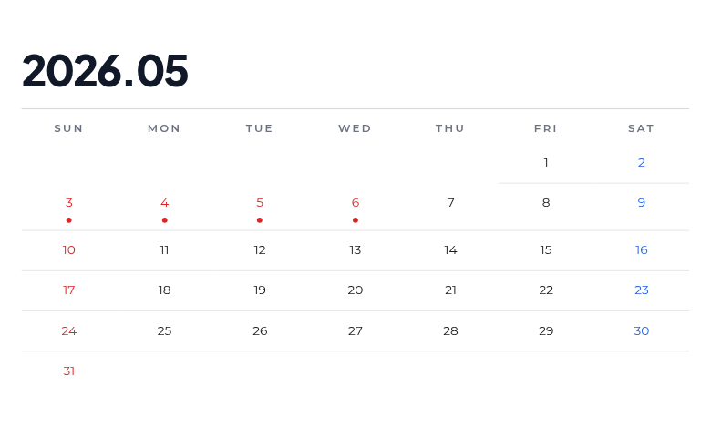 | 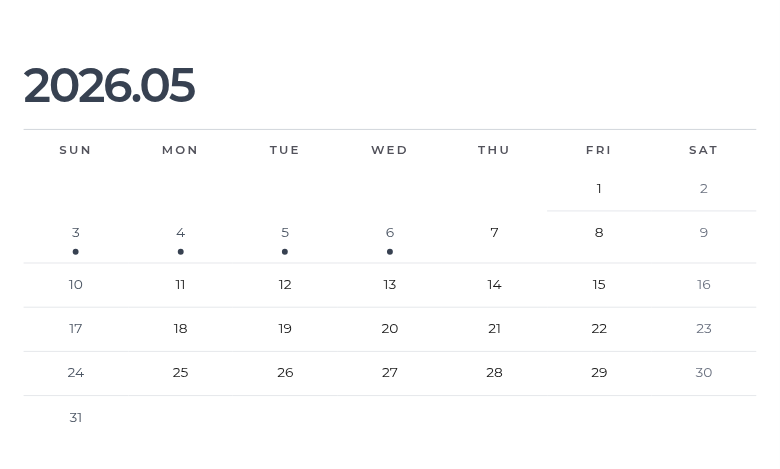 |
| **Slate**                                                     | **Sepia**                                                           |
| 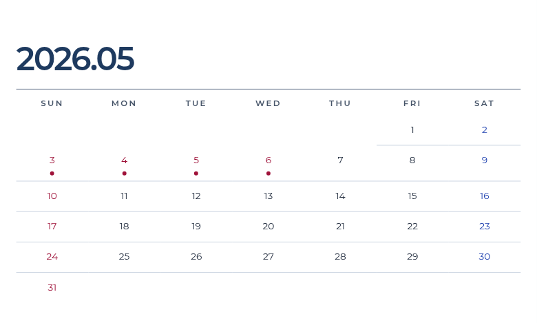     | 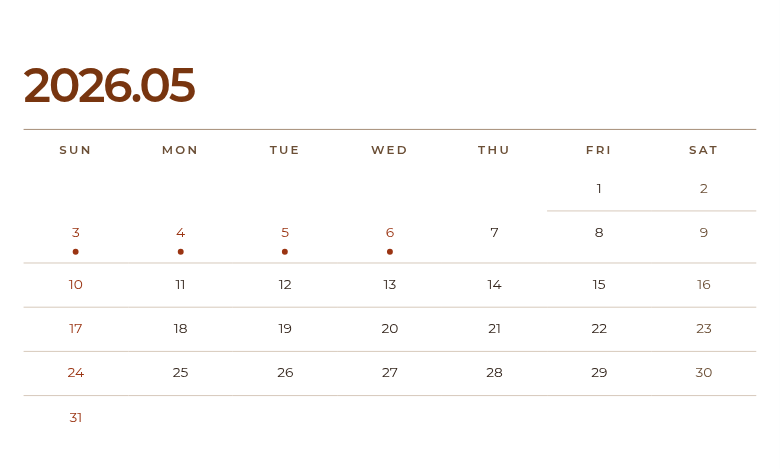           |
| **Forest**                                                    | **Minimal**                                                         |
| 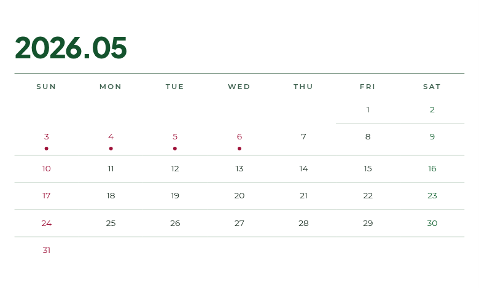   | 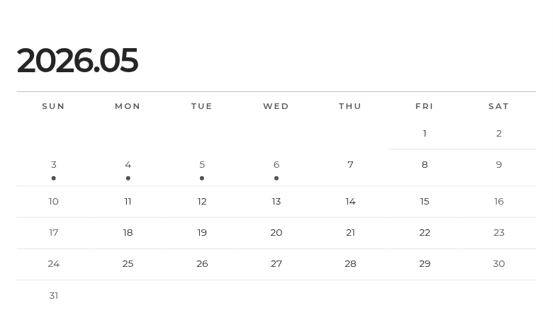       |

### フォント

テーマは Classic、日付の太さは標準（400）で統一しています。選んだフォントは年月タイトル、曜日、日付に適用されます。

| Montserrat                                                                       | Inter                                                                              |
| -------------------------------------------------------------------------------- | ---------------------------------------------------------------------------------- |
|                  | 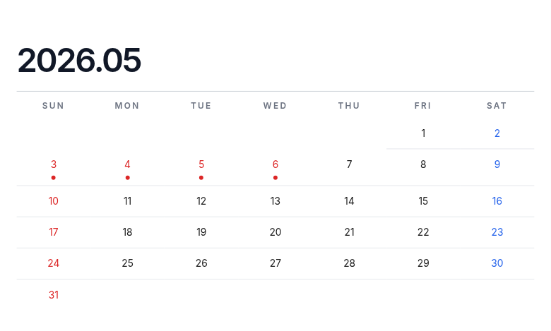                           |
| **Noto Sans JP**                                                                 | **IBM Plex Sans**                                                                  |
| 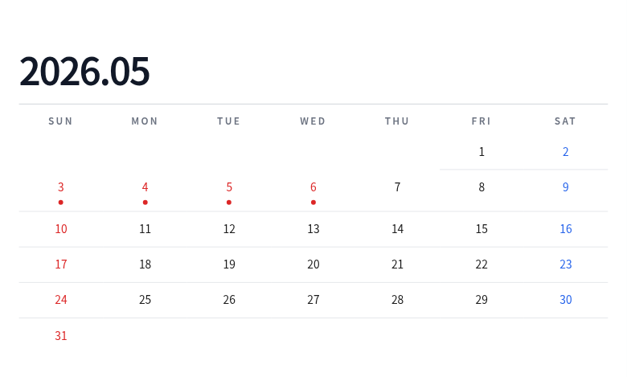           |            |
| **Lato**                                                                         |                                                                                    |
| 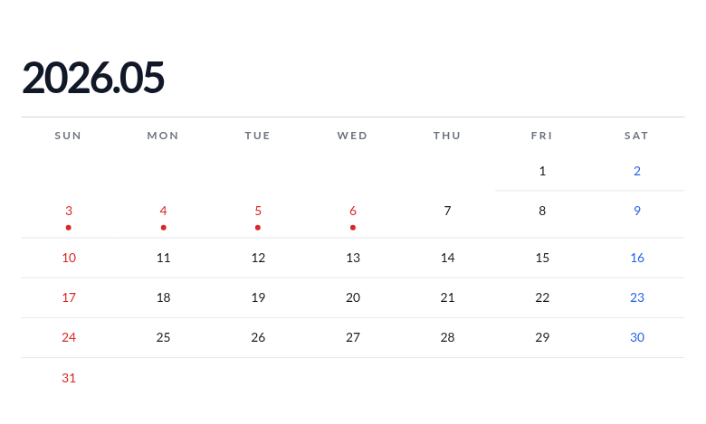                           |                                                                                    |
| **Zen Maru Gothic**                                                              | **Nunito**                                                                         |
| 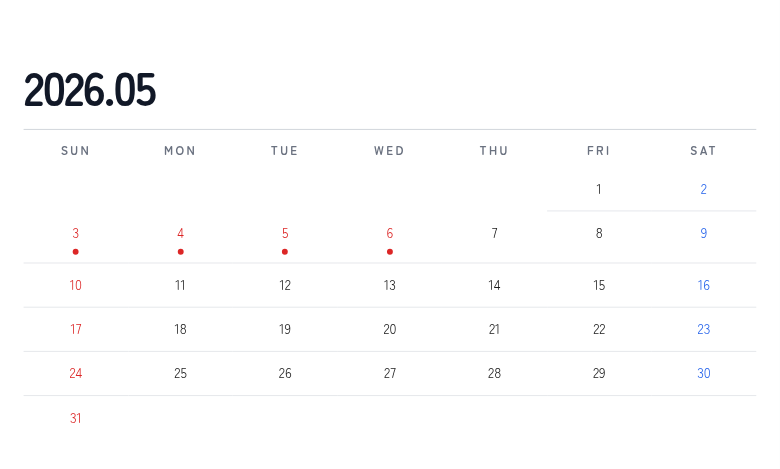     |                          |
| **M PLUS Rounded 1c**                                                            | **Cormorant Garamond**                                                             |
| 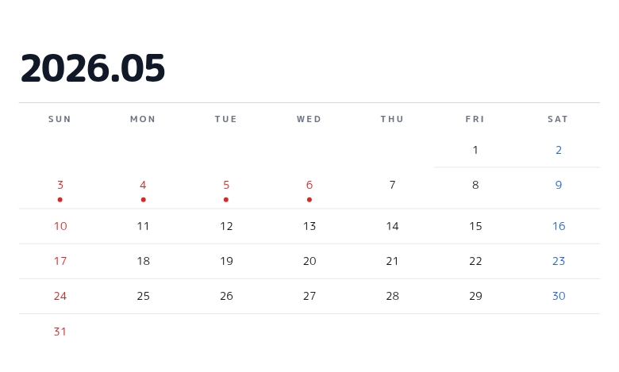 | 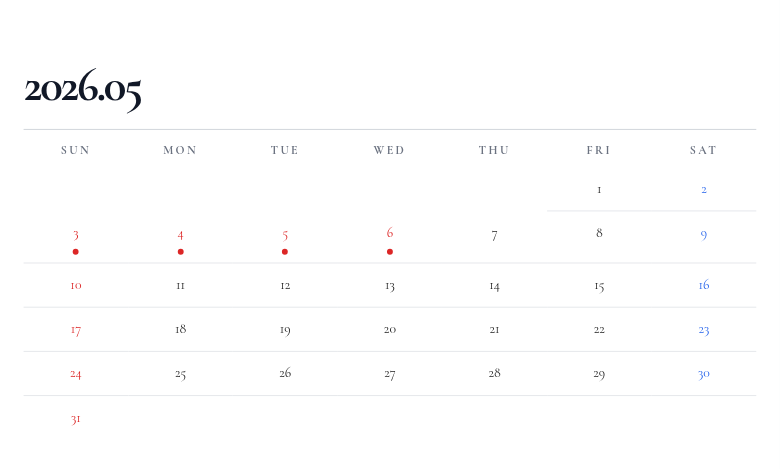 |
| **Playfair Display**                                                             | **Shippori Mincho**                                                                |
| 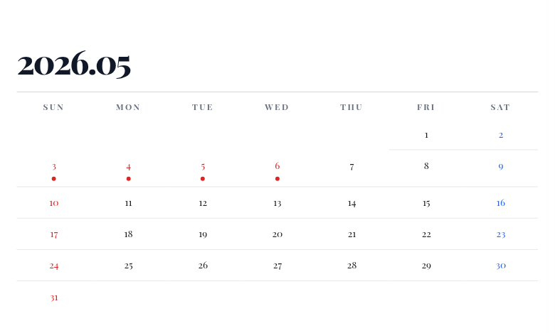   | 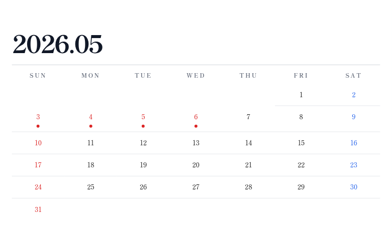       |

### テーマとフォントの組み合わせ

| Slate × IBM Plex Sans                                                              | Sepia × Noto Sans JP                                                             |
| ---------------------------------------------------------------------------------- | -------------------------------------------------------------------------------- |
| 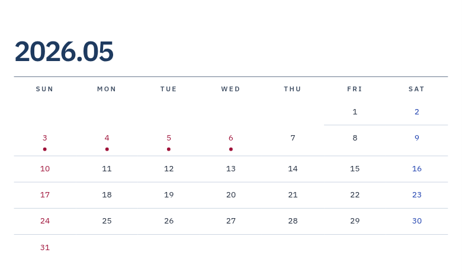 | 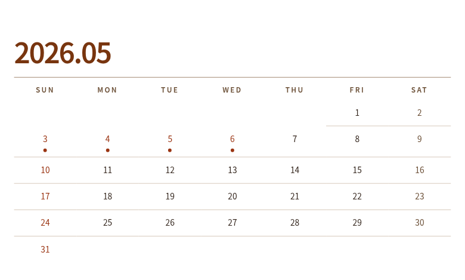 |

### フォントの太さ

Classic と Montserrat の組み合わせで、日付の数字の太さを比較できます。

| 細字（300）                                            | 標準（400）                                               | 太字（600）                                            |
| ------------------------------------------------------ | --------------------------------------------------------- | ------------------------------------------------------ |
| 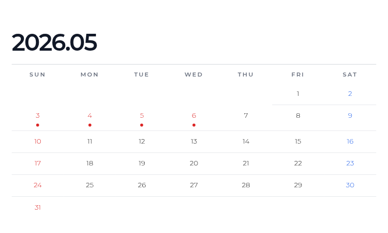 |  | 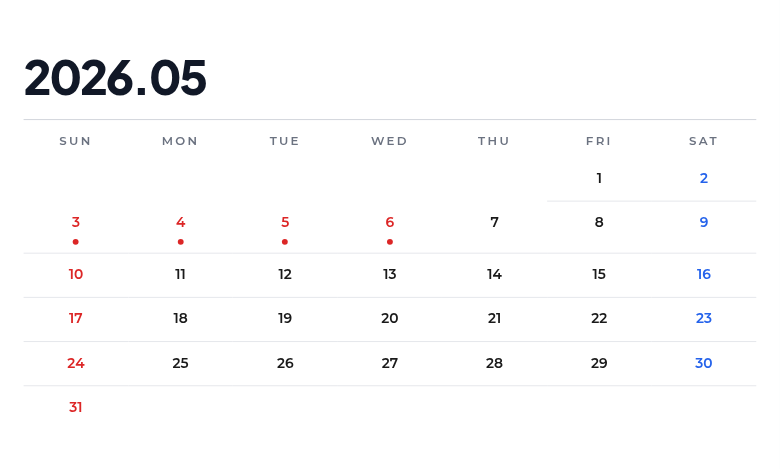 |

## レイアウト見本

設定の「見た目 → プリセット」から、標準を含む10種類の見本を選べます。レイアウトごとの初期文字サイズで、2027年6月を表示した見本です。プリセットごとに用紙の向きと画像の位置が切り替わります。縦リストはA4横向きで画像が左、他のプリセットはA4縦向きで画像が上です。

プリセットの下にテーマとフォントがあります。「サイズと配置」では月見出しの位置・年月の並べ方・下線、日付と曜日の揃え、文字サイズ、用紙内の余白を調整できます。プリセットを選び直すと構成の初期値が入り、テーマと上余白は引き継がれます。書体と年月表記はプリセットごとの設定に切り替わります。クラシカルでは Shippori Mincho と「June 2027」の形式を使います。

日付欄の縦罫線・横罫線・枠を個別に切り替えられます。縦罫線は列の間に入り、全体を囲むには「枠」をオンにします。

日付の左右・上下揃えは別々に指定できます。「自動」を選ぶとレイアウト本来の揃え方になります。

| クラシカル                                            | 右揃え・線なし                                           |
| ----------------------------------------------------- | -------------------------------------------------------- |
| 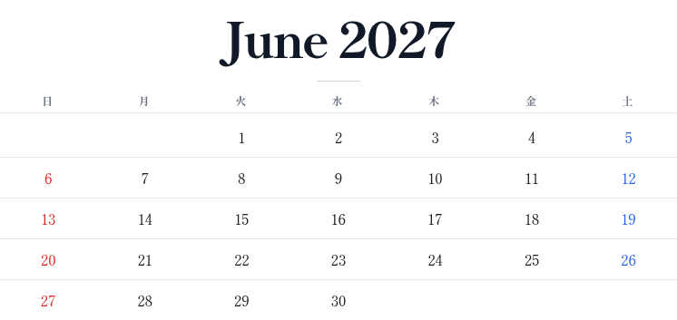       | 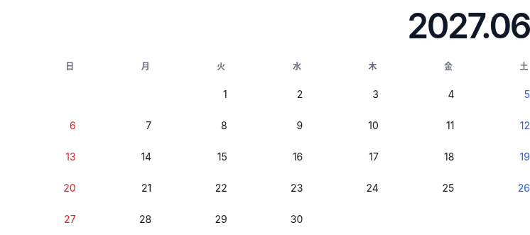 |
| **年月を上下に**                                      | **月は左、年は右**                                       |
| 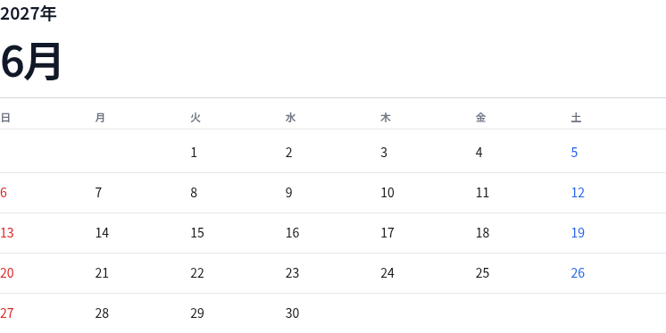      | 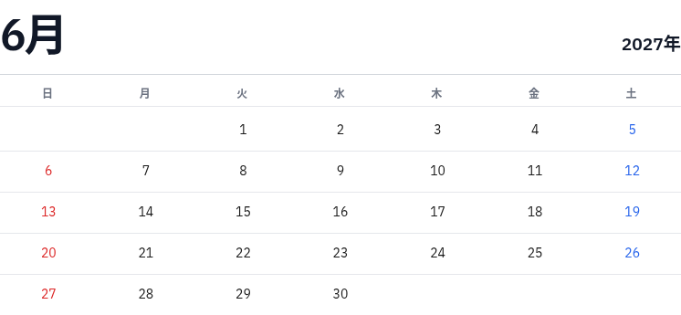         |
| **左サイド見出し**                                    | **日付カード**                                           |
| 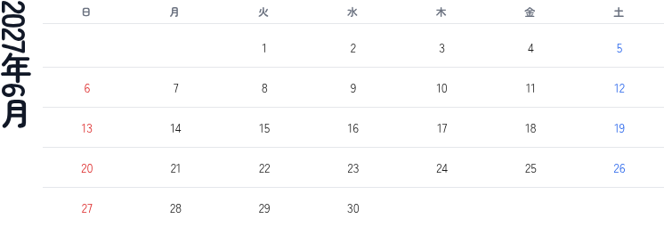 | 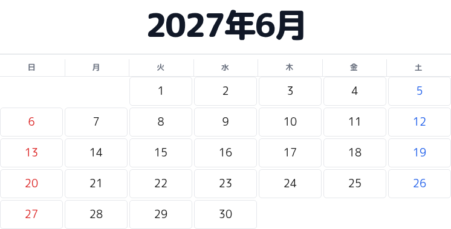             |
| **標準**                                              | **書き込み用**                                           |
| 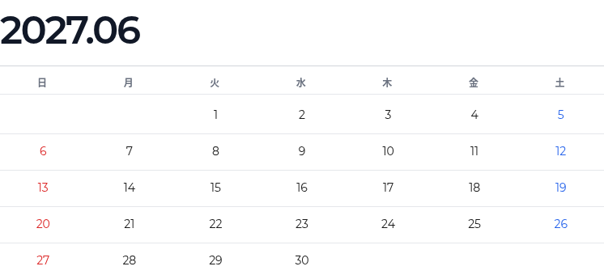             | 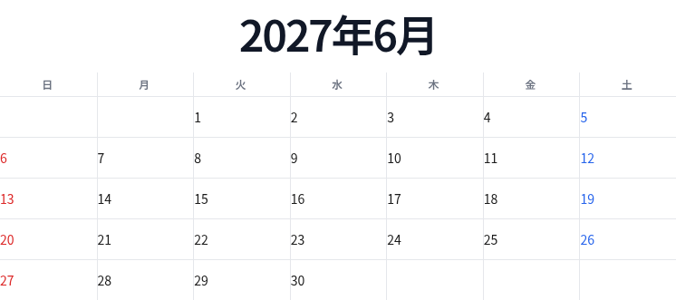           |
| **週ごとの帯**                                        | **縦リスト**                                             |
| 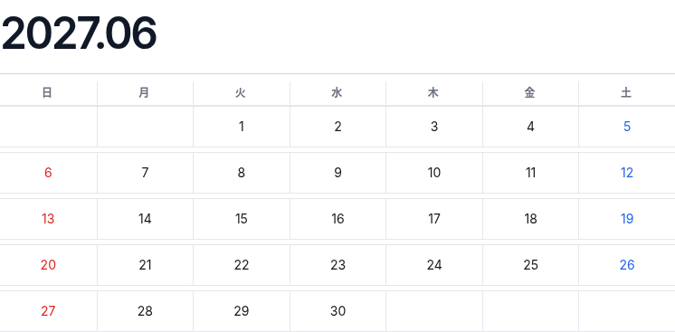     | 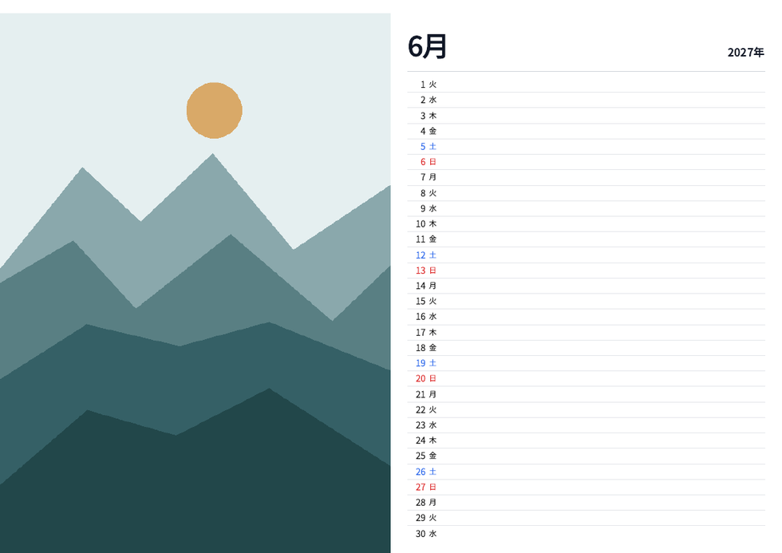           |

## 機能一覧

### カレンダー設定

- **任意の期間指定**: 1〜24ヶ月、開始月・終了月を自由に設定
- **用紙の向き**: 縦 / 横（A4固定）
- **週の開始曜日**: 日曜 / 月曜
- **曜日・月の表記**: 日本語 / 英語短縮 / 英語完全

### 祝日

- **自動取得**: [holidays-jp API](https://holidays-jp.github.io/) から取得（7日間キャッシュ + ハードコードフォールバック）
- **祝日マーク**: ドット / 丸囲み / 下線 / 色のみ
- **手動編集**: 会社の休日等を追加・削除、API祝日の非表示・復元

### デザイン

- **白背景のカラーテーマ6種**: Classic, Monochrome, Slate, Sepia, Forest, Minimal
- **Google Fonts 11種**: 「かっこいい」「しっかり」「かわいい」「おしゃれ」のカテゴリ別に、見本を見て選択
- **文字サイズ・余白カスタマイズ**: 月タイトル、日付、曜日のフォントサイズ、セル余白、ヘッダー間隔、上余白（初期値20px）をスライダーで調整

### 画像

- **プレビュー上で直接操作**: カレンダーページの画像エリアをクリックまたはドラッグ＆ドロップ
- **画像ON/OFF**: デザイン設定で画像なしカレンダーに切り替え可能
- **比率プリセット**: 60:40 / 50:50 / 70:30

### 出力

- **PDF**: ブラウザの印刷ダイアログから直接PDF保存
- **HTML**: 単一HTMLファイル（画像base64埋め込み + 設定JSON埋め込み）
- **ZIP**: HTML + 画像ファイル

### インポート/エクスポート

- **設定をJSON保存/読込**: カレンダー設定をファイルで保存・復元
- **HTMLから読込**: エクスポートしたHTMLファイルから設定を復元して編集を再開

### UI

- **リアルタイムプレビュー**: A4比率の連続スクロール表示 + 月ジャンプナビゲーション
- **レスポンシブ対応**: PC（2カラム）/ スマホ（ボトムシート設定）
- **日本語UI**: 全インターフェースが日本語
- **印刷ガイド**: ヘルプモーダルにブラウザPDF化 + コンビニ印刷の手順

## 技術スタック

| カテゴリ         | 技術                                               |
| ---------------- | -------------------------------------------------- |
| フレームワーク   | React 19 + TypeScript                              |
| ビルドツール     | [Vite+](https://viteplus.dev/) (Vite 8 + Rolldown) |
| スタイリング     | Tailwind CSS v4                                    |
| UIコンポーネント | shadcn/ui (base-ui)                                |
| 状態管理         | Zustand                                            |
| デザインシステム | Ethereal Glass                                     |
| Lint / Format    | Oxlint + Oxfmt (Vite+内蔵)                         |
| 型チェック       | tsgo (Vite+内蔵)                                   |
| テスト           | Vitest + @testing-library/react + Playwright       |
| ZIP生成          | JSZip                                              |

## 前提条件

- Node.js 26 LTS（開発・CI のバージョンは `.node-version`）
- pnpm（バージョンは `package.json` の `packageManager`）
- [Vite+](https://viteplus.dev/) CLIがグローバルインストール済みであること

```bash
# macOS/Linux
curl -fsSL https://vite.plus | bash

# Windows (PowerShell)
irm https://vite.plus/ps1 | iex
```

## 開発の始め方

```bash
# 依存関係のインストール
vp install

# 開発サーバーの起動
vp dev

# コードチェック（フォーマット + lint + 型チェック）
vp check

# テスト実行
vp test

# プロダクションビルド
vp build
```

## プロジェクト構成

```
src/
├── components/
│   ├── ui/                 # shadcn/ui プリミティブ
│   ├── sidebar/            # 設定パネル（アコーディオン、複数同時展開可）
│   ├── preview/            # カレンダープレビュー（A4ページ、画像D&D）
│   ├── download/           # 出力ボタン（PDF/HTML/ZIPドロップダウン）
│   └── layout/             # ヘッダー、ヘルプモーダル、ボトムシート
├── stores/
│   ├── calendarStore.ts    # Zustandストア（同期setterのみ）
│   └── types.ts            # 全型定義
├── lib/
│   ├── dateUtils.ts        # 純粋関数: 月範囲生成、グリッド計算
│   ├── holidayUtils.ts     # 純粋関数: 祝日マージ
│   ├── holidayService.ts   # DI対応: API取得 + キャッシュ
│   ├── themeUtils.ts       # 純粋関数: テーマ解決
│   ├── layoutUtils.ts      # 純粋関数: 画像/グリッド比率
│   ├── imageService.ts     # DI対応: 画像リサイズ + base64変換
│   ├── htmlGenerator.ts    # 純粋関数: PageData[] → HTML（設定JSON埋め込み対応）
│   ├── htmlImporter.ts     # HTMLからの設定復元
│   ├── zipGenerator.ts     # 純粋関数: PageData[] → ZIP
│   ├── settingsExport.ts   # 設定のJSON化 / JSON復元
│   ├── themes.ts           # 6テーマ定義
│   ├── fonts.ts            # 11フォントプリセット
│   └── constants.ts        # A4寸法、デフォルト値
└── hooks/
    ├── useFontLoader.ts    # Google Fonts動的ロード
    ├── useHolidays.ts      # 祝日API取得 → ストア書き込み
    └── useImageUpload.ts   # 画像リサイズ → ストア書き込み
```

## アーキテクチャ

- **完全クライアントサイド**: バックエンド・DB不要。画像・設定データはブラウザ外に送信しない
- **テスト容易性重視**: 純粋関数によるロジック分離、外部APIの依存注入、Container/Presentational分離
- **印刷対応出力**: `@page` CSS、`print-color-adjust: exact`、プレビューと一致するインラインスタイル
- **レスポンシブ**: PC（サイドバー + プレビュー）/ スマホ（ボトムシート + FAB）

## テスト

```bash
# ユニットテスト（104テスト）
vp test

# ウォッチモード
vp test --watch

# カバレッジレポート
vp test --coverage

# E2Eテスト（13テスト）
npx playwright test
```

## ドキュメント

| ファイル                | 内容                                 |
| ----------------------- | ------------------------------------ |
| `docs/requirements.md`  | 90項目の要件チェックリスト           |
| `docs/design.md`        | アーキテクチャ、型定義、データフロー |
| `docs/design-system.md` | Ethereal Glass デザインシステム      |

## デプロイ

本番環境は Cloudflare Workers で配信します。設定は `wrangler.jsonc` にあります。

静的ホスティングで配信する場合は、以下のコマンドで `dist/` を生成します。

```bash
pnpm run build
```

## ライセンス

MIT
